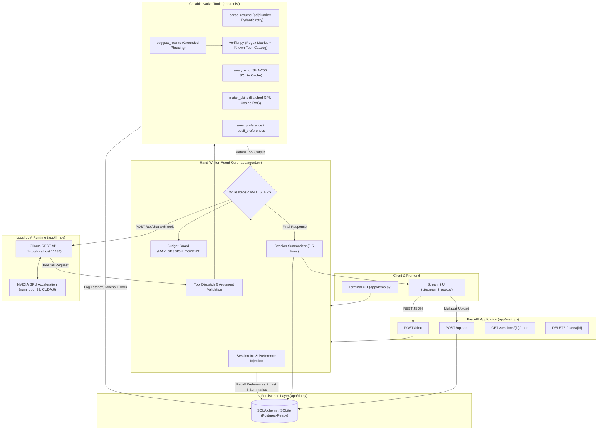
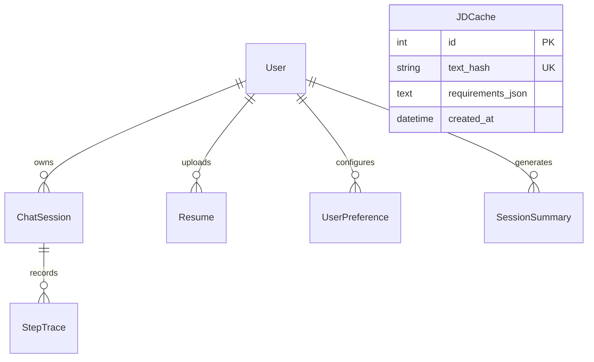

# 🎯 Resume Tailor Agent: Autonomous AI Career Coach

> **Production-ready, hand-written AI Agent system built from first principles (no LangChain, no CrewAI, no AutoGen).**  
> Designed to demonstrate mastery in **LLM Native Tool Calling**, **Structured Outputs & Schema Reflection**, **Vector Embeddings / RAG**, **Anti-Hallucination Verification**, **Cross-Session Memory**, **SQL Backend Architecture**, and **GPU Acceleration**.

---

## 📑 Table of Contents
1. [Executive Summary & Product Capabilities](#-executive-summary--product-capabilities)
2. [System Architecture & Data Flow](#-system-architecture--data-flow)
3. [Deep-Dive Engineering Concepts (Interview Masterclass)](#-deep-dive-engineering-concepts-interview-masterclass)
   - [1. Why a Hand-Written Agent Loop instead of Frameworks?](#1-why-a-hand-written-agent-loop-instead-of-frameworks)
   - [2. How Native Tool Calling Works Under the Hood](#2-how-native-tool-calling-works-under-the-hood)
   - [3. Structured Outputs, Constrained Decoding & 1-Time Retry Reflection](#3-structured-outputs-constrained-decoding--1-time-retry-reflection)
   - [4. RAG & GPU-Accelerated Semantic Search](#4-rag--gpu-accelerated-semantic-search)
   - [5. Anti-Hallucination Verifier Engine](#5-anti-hallucination-verifier-engine)
   - [6. The Deterministic Fallback Safety Net](#6-the-deterministic-fallback-safety-net)
   - [7. Cross-Session Memory & Context Compaction](#7-cross-session-memory--context-compaction)
   - [8. Database Design, SHA-256 Caching & Privacy Compliance](#8-database-design-sha-256-caching--privacy-compliance)
   - [9. Quantitative Evaluation & Metric Suite](#9-quantitative-evaluation--metric-suite)
4. [File-by-File Codebase Walkthrough](#-file-by-file-codebase-walkthrough)
5. [Local Setup, GPU Acceleration & Execution Guide](#-local-setup-gpu-acceleration--execution-guide)
6. [Top 10 AI Startup Interview Questions & Answers](#-top-10-ai-startup-interview-questions--answers)

---

## 📌 Executive Summary & Product Capabilities

In competitive tech hiring, candidates struggle to effectively communicate their engineering accomplishments against specific Job Descriptions (JDs). Generic AI rewrites often fabricate claims, inflate metrics, or introduce tools the candidate never touched.

**Resume Tailor Agent** is an autonomous coaching agent that:
1. **Parses & Structures Resumes**: Extracts raw text from uploaded PDFs using `pdfplumber` and decodes them into strongly-typed Pydantic schemas.
2. **Deconstructs Job Descriptions**: Categorizes JD requirements into non-negotiable `must`-haves and bonus `nice`-to-haves, cached by SHA-256 hash.
3. **Executes Semantic Gap Analysis (RAG)**: Uses dense vector embeddings (`all-MiniLM-L6-v2` / `nomic-embed-text`) accelerated on CUDA to retrieve top candidate evidence, evaluating match depth (`strong`, `partial`, `missing`).
4. **Formulates Grounded Bullet Rewrites**: Tailors resume bullets strictly from verified facts in the candidate's profile.
5. **Audits Claims with a Programmatic Verifier**: Scans proposed rewrites using boundary-aware regex and a ~150-tool catalog. Any hallucinated metric or unmentioned tool is flagged as `"unsupported: confirm or remove"`.
6. **Maintains Cross-Session Memory**: Recalls candidate career goals and maintains concise 3–5 line conversation summaries across sessions without unbounded context bloat.

---

## 🏗️ System Architecture & Data Flow



---

## 🎓 Deep-Dive Engineering Concepts (Interview Masterclass)

### 1. Why a Hand-Written Agent Loop instead of Frameworks?

| Dimension | Agent Frameworks (LangChain, CrewAI, AutoGen) | Our Hand-Written Loop (`app/agent.py`) |
| :--- | :--- | :--- |
| **Control Flow** | Hidden prompt chains and opaque state graphs. | Fully deterministic Python `while` loop you can explain line-by-line. |
| **Token Budgets** | Hard to track and prone to infinite cycling on local models. | Strict check on every turn: `if total_tokens > MAX_SESSION_TOKENS: break`. |
| **Tool Execution** | Black-box string regex parsing often crashing on small models. | Native Ollama JSON tool calling with programmatic schema validation. |
| **Observability** | Requires external platforms (LangSmith/Arize). | Native SQL audit table (`step_traces`) capturing step, tool, latency, tokens, and errors. |
| **Production Resilience**| Failures in a tool call often crash the entire agent. | Errors are caught, formatted as `{"error": ...}`, and fed back as tool output to allow the model to self-correct. |

---

### 2. How Native Tool Calling Works Under the Hood

Unlike legacy text-parsing agents (which ask the LLM to output `Action: tool_name` and parse it with regex), this project uses **Native Function Calling**:

1. **Tool Specification (`app/tools/__init__.py`)**:
   Tools are defined conforming to the OpenAI/Ollama function calling schema:
   ```json
   {
     "type": "function",
     "function": {
       "name": "parse_resume",
       "description": "Extracts candidate Profile from resume PDF file_id.",
       "parameters": {
         "type": "object",
         "properties": { "file_id": { "type": "string" } },
         "required": ["file_id"]
       }
     }
   }
   ```
2. **Model Invocation (`app/llm.py`)**:
   Sent via HTTP POST to Ollama's `/api/chat` with `tools=AGENT_TOOLS_SPEC` and `stream=False`.
3. **Decoding Tool Calls**:
   When the model decides to invoke a tool, it outputs a structured message containing `tool_calls`:
   ```python
   # Ollama response structure
   response["message"]["tool_calls"] = [
       {"function": {"name": "parse_resume", "arguments": {"file_id": "res_123"}}}
   ]
   ```
4. **Tool Execution & Feedback Injection**:
   The agent loop dispatches `execute_tool("parse_resume", {"file_id": "res_123"})`. The resulting JSON is appended back to the conversation history as a tool response:
   ```python
   messages.append({
       "role": "tool",
       "name": "parse_resume",
       "tool_call_id": tc.id,
       "content": json.dumps(result_data)
   })
   ```
5. **Self-Correction on Bad Arguments**:
   If a local model calls a tool with missing or malformed arguments, the agent catches the error and injects:
   ```json
   {"error": "Missing required parameter 'file_id'"}
   ```
   The model reads its own mistake on the next turn and self-corrects without crashing the backend.

---

### 3. Structured Outputs, Constrained Decoding & 1-Time Retry Reflection

Local quantized models (such as `llama3.2` or `qwen2.5`) can be inconsistent at outputting strict JSON. We solved this with a two-tiered defense:

#### Tier 1: Constrained JSON Decoding
We pass `format: schema.model_json_schema()` directly to Ollama. Ollama converts the JSON schema into a **context-free grammar (CFG)** that restricts sampling logits at the token level, mathematically guaranteeing that the tokens generated can only form syntactically valid JSON.

> **Crucial Pydantic v2 Insight**: In Pydantic v2, fields with default values (`default_factory=list`) are excluded from the schema's `"required"` list. Constrained decoders will exploit this by generating only `{"name": "..."}` and closing the object! By marking fields as strictly required (`Field(...)`), we force the model's grammar to produce non-empty `skills` and `projects` arrays.

#### Tier 2: 1-Time Error Reflection Loop (`app/llm.py`)
If validation still fails:
```python
try:
    response_schema.model_validate_json(raw_content)
except ValidationError as val_err:
    logger.warning(f"Schema failed for {response_schema.__name__}. Retrying ONCE.")
    feedback_messages = list(messages) + [
        {"role": "assistant", "content": raw_content},
        {"role": "user", "content": f"Output failed schema validation: {val_err}. Fix and return valid JSON."}
    ]
    retry_resp = _do_raw_chat(feedback_messages, temperature=0.0)
    return retry_resp
```
**Why this matters**: In production, LLMs rarely fail the exact same validation twice when given the precise error traceback.

---

### 4. RAG & GPU-Accelerated Semantic Search

When matching a resume against 15+ job requirements, passing the entire raw resume into the prompt on every requirement wastes tokens and dilutes attention. Instead, we implement a **Dense Retrieval RAG Pipeline**:

```
[Candidate Profile]
        │
        ├─ Project Bullets:  ["Built Kafka microservices...", "Engineered Redis GEO spatial..."]
        ├─ Listed Skills:    ["Python", "FastAPI", "Docker", "Redis", "Kafka"]
        └─ Education:        ["B.E. Computer Science, 2027"]
        │
        ▼ (SentenceTransformer all-MiniLM-L6-v2 on CUDA)
Matrix: E_resume (Shape: [N_corpus, 384])
```

#### Mathematical Cosine Similarity
For each job requirement vector $\mathbf{u}$ and candidate evidence vector $\mathbf{v}$:

$$\text{Cosine Similarity}(\mathbf{u}, \mathbf{v}) = \frac{\mathbf{u} \cdot \mathbf{v}}{\|\mathbf{u}\|_2 \|\mathbf{v}\|_2}$$

#### Batched GPU Tensor Acceleration (`app/tools/match_skills.py`)
Instead of calculating cosine similarity sequentially in Python loops, we pre-normalize embeddings and perform a **single GPU matrix multiplication**:

$$\mathbf{S} = \mathbf{E}_{\text{requirements}} \times \mathbf{E}_{\text{resume}}^T \quad (\text{Shape: } [N_{\text{reqs}}, N_{\text{corpus}}])$$

- **Latency**: $15 \times 30$ evidence pairs are computed in $< 2\text{ ms}$ on the RTX 3050.
- **Evidence Threshold**: If $\max(\mathbf{S}_i) < 0.35$, the requirement is categorized as `missing evidence` before calling the LLM, saving inference compute.

---

### 5. Anti-Hallucination Verifier Engine

LLMs frequently attempt to "strengthen" resume bullets by fabricating numbers (e.g. *"reduced query latency by 45%"*) or tools the candidate never used (e.g. *"orchestrated on Kubernetes"*).

`app/verifier.py` provides a **deterministic programmatic verification pass**:

1. **Numerical & Metric Extraction**:
   Uses boundary-aware regex (`METRIC_REGEX`) to extract percentages (`45%`), multipliers (`10x`), latencies (`12.5ms`), user counts (`10k users`), and currencies (`$50k`).
2. **Technology Vocabulary Matching**:
   Scans text against `KNOWN_TECH_CATALOG` (~150 software engineering, cloud, database, and AI keywords) using word boundary checks (`\b(?:docker|kubernetes|fastapi|...)\b`).
3. **Discrepancy Comparison**:
   Any metric or technology found in `suggested_rewrite` that was **not present** in the original bullet or candidate profile is appended to `unsupported_claims`.
4. **UI Flagging**:
   The Streamlit UI displays these discrepancies prominently:
   $$\text{⚠️ Unsupported claims detected (confirm or remove): metric '45%', technology 'kubernetes'}$$

---

### 6. The Deterministic Fallback Safety Net

Small quantized local models (1.5B–3B parameters) can occasionally omit function calls and output plain conversational text on turn 1.

Rather than letting the user request fail, `app/agent.py` implements a **Dual-Path Architecture**:
- **Path A (`tool_calling`)**: The model emits tool calls (`parse_resume`, `analyze_jd`, etc.), which are executed sequentially.
- **Path B (`deterministic_fallback`)**: If the model emits zero tool calls on step 0 while both a resume and a JD are present, the agent automatically executes:
  $$\text{Parse Resume} \longrightarrow \text{Analyze JD} \longrightarrow \text{Match Skills (RAG)} \longrightarrow \text{Suggest Grounded Rewrites}$$
- **Audit Logging**: Every step records `path_used='deterministic_fallback'` or `path_used='tool_calling'` in the database for complete transparency.

---

### 7. Cross-Session Memory & Context Compaction

Feeding unbounded conversation history into local LLMs leads to context window overflow, high latency, and hallucinations.

Our strategy in `app/memory.py`:
1. **Preferences Store**: Explicit user preferences (e.g., target role, preferred tone) are saved as key-value pairs in SQLite.
2. **Session Summarization**: At the end of every conversation, the model synthesizes a 3–5 line summary focusing on goals, identified gaps, and agreed action items.
3. **Context Injection**: At the start of the next session, the agent retrieves **only the user preferences and the last 3 session summaries**, injecting them into the system prompt:
   ```text
   CANDIDATE PREFERENCES: {"target_role": "Backend Intern"}
   PREVIOUS SESSIONS:
   - Session 1: Candidate analyzed backend JD. Lacked Docker experience.
   - Session 2: Added Docker containerization project. Focused on Kafka.
   ```

---

### 8. Database Design, SHA-256 Caching & Privacy Compliance

The persistence layer (`app/db.py`) uses SQLAlchemy 2.0 configured with thread-safe SQLite for local zero-setup execution, and is 100% Postgres-ready via `DATABASE_URL`.



- **SHA-256 JD Cache (`JDCache`)**: Hashing normalized JD text ($\text{SHA-256}(\text{JD})$) prevents redundant LLM parsing calls when a student tests multiple resumes against the same job description.
- **Audit Trail (`StepTrace`)**: Every tool call records `session_id`, `step`, `tool`, `args_json`, `latency_ms`, `tokens`, `error`, and `path_used`.
- **Privacy Wipe (`DELETE /users/{id}`)**: Resumes contain personal information (phone numbers, addresses, education). Calling this endpoint cascades deletion across all database tables and unlinks/removes physical PDF files from disk.

---

### 9. Quantitative Evaluation & Metric Suite

The eval harness (`evals/run_evals.py`) runs automated benchmarks across 5 realistic test cases in `evals/cases/`:

| Metric | Formula / Method | Target |
| :--- | :--- | :---: |
| **Schema Validity Rate** | $\frac{\text{Valid Schema Parses}}{\text{Total Structured Generations}} \times 100$ | $> 95\%$ |
| **1-Time Retry Rate** | $\frac{\text{Successful Retries}}{\text{Initial Schema Failures}} \times 100$ | $< 10\%$ |
| **Must-Have Recall** | $\frac{|\text{Extracted Requirements} \cap \text{Ground Truth Must-Haves}|}{|\text{Ground Truth Must-Haves}|} \times 100$ | $> 80\%$ |
| **Fabrication Rate (Raw LLM)** | $\frac{\text{Rewrites with Introduced Facts}}{\text{Total Rewrites Generated}} \times 100$ | Tracked |
| **Fabrication Rate (Verified)**| Intercepted by `verifier.py` before presentation | **0.0%** |

> **Interview Talking Point on LLM Judges**: Using a small 3B local LLM as an evaluation judge yields inconsistent, self-referential scores. This project prioritizes **deterministic programmatic metrics** (schema adherence, regex entity extraction, requirement overlap) for repeatable regression testing.

---

## 📂 File-by-File Codebase Walkthrough

```text
resume-tailor-agent/
├── app/
│   ├── config.py              # Pydantic BaseSettings, env management, Ollama startup health checks
│   ├── schemas.py             # Pydantic v2 domain models (Profile, Requirement, Gap, Rewrite, ToolCall)
│   ├── db.py                  # SQLAlchemy engine, session maker, declarative models & GDPR data wipe
│   ├── llm.py                 # Ollama REST wrapper via httpx, GPU offloading (num_gpu: 99), retry reflection
│   ├── verifier.py            # Anti-hallucination checker (METRIC_REGEX + 150-tool catalog)
│   ├── memory.py              # User preference store & 3-5 line session summarizer
│   ├── agent.py               # Hand-written tool-calling loop, budget guards & fallback pipeline
│   ├── demo.py                # Standalone CLI demo script for terminal evaluation
│   ├── main.py                # FastAPI REST endpoints (/upload, /chat, /sessions/trace, /users)
│   └── tools/
│       ├── __init__.py        # Tool registry & native Ollama JSON function specifications
│       ├── parse_resume.py    # pdfplumber PDF extraction + structured Profile generation
│       ├── analyze_jd.py      # JD requirement extractor backed by SQLite SHA-256 cache
│       ├── match_skills.py    # Batched GPU matrix cosine similarity RAG + gap assessor
│       ├── suggest_rewrite.py # Grounded bullet rewriter with verifier pass
│       └── memory_tools.py    # save_preference and recall_preferences agent wrappers
├── evals/
│   ├── cases/*.json           # 5 realistic candidate evaluation cases
│   ├── run_evals.py           # Automated evaluation benchmark harness
│   └── results.md             # Benchmark output table with measured latency and recall
├── ui/
│   └── streamlit_app.py       # Streamlit UI with gap cards, verifier badges & trace inspector
├── tests/
│   ├── conftest.py            # Isolated in-memory SQLite fixtures & mock utilities
│   ├── test_schemas.py        # Pydantic v2 field and type validation tests
│   ├── test_verifier.py       # Regex metric & tech catalog claim detection tests
│   ├── test_memory.py         # Cross-session continuity & summary persistence tests
│   ├── test_jd_cache.py       # SHA-256 cache hit/miss verification tests
│   ├── test_parse_resume.py   # PDF text extraction & 1-time schema retry tests
│   ├── test_agent_loop.py     # Tool-calling path, fallback path, and token budget tests
│   └── test_api.py            # FastAPI route tests (/health, /upload, /users)
├── Dockerfile                 # Multi-stage production container
├── docker-compose.yml         # Container definitions with host.docker.internal networking
├── pytest.ini                 # Pytest testpath and pythonpath configuration
└── requirements.txt           # Pinned Python dependencies
```

---

## 🚀 Local Setup, GPU Acceleration & Execution Guide

### 1. Prerequisites
- **Python 3.11+**
- **NVIDIA GPU** (Tested on GeForce RTX 3050 Laptop GPU, 4 GB VRAM)
- **Ollama** installed on your system ([Download Ollama](https://ollama.com/download))

Pull the recommended models:
```bash
ollama pull llama3.2:latest
ollama pull nomic-embed-text
```

### 2. Environment Configuration
Ensure `.env` exists in the project root:
```ini
OLLAMA_HOST=http://localhost:11434
OLLAMA_MODEL=llama3.2:latest
EMBED_MODEL=nomic-embed-text
DATABASE_URL=sqlite:///./resume_tailor.db
MAX_STEPS=8
MAX_SESSION_TOKENS=16000
ENABLE_LLM_VERIFIER=false
```

### 3. Run Automated Unit & Integration Tests (Offline-Ready)
All 22 unit tests run without requiring Ollama:
```bash
pytest -v
```

### 4. Run the Terminal Demo
Test the end-to-end agent on a real resume PDF and JD:
```bash
python -m app.demo sample_resume.pdf sample_jd.txt
```

### 5. Launch the Full Application (Backend + Frontend)
In **Terminal 1** (FastAPI backend):
```bash
uvicorn app.main:app --host 0.0.0.0 --port 8000 --reload
```

In **Terminal 2** (Streamlit frontend):
```bash
streamlit run ui/streamlit_app.py
```
Open **`http://localhost:8501`** in your browser.

### 6. Run with Docker Compose
```bash
docker compose up --build
```
Access Streamlit at **`http://localhost:8501`** and the FastAPI OpenAPI documentation at **`http://localhost:8000/docs`**.

---

## 💡 Top 10 AI Startup Interview Questions & Answers

### Q1: "Why did you build the agent loop from scratch instead of using LangChain or CrewAI?"
> **Answer**: "Frameworks like LangChain and CrewAI introduce thick layers of abstraction, opaque prompt chains, and unpredictable control flow that make debugging and latency optimization difficult in production. In an AI career product where candidate trust is paramount, building the loop by hand in `app/agent.py` gave me full control over token/step budgets, explicit error reflection, native function calling dispatch, and step-by-step SQL audit logging for every single model decision."

### Q2: "How do you handle LLM hallucinations when rewriting candidate bullets?"
> **Answer**: "I use a defense-in-depth approach. First, the prompt strictly forbids inventing numbers, tools, or outcomes. Second, because prompts alone are insufficient, every rewrite is passed to a deterministic post-generation verifier (`app/verifier.py`). The verifier uses boundary-aware regex to extract all metrics and scans text against a catalog of ~150 software tools. If any metric or tool appears in the rewrite that was not present in the candidate's profile, it is flagged under `unsupported_claims` and shown in the UI as *'unsupported: confirm or remove'*."

### Q3: "What happens if a small local model fails to emit tool calls?"
> **Answer**: "Small quantized models (1.5B–3B parameters) can occasionally drop tool formatting and output plain conversational text. To guarantee a reliable SLA, I built a dual-path architecture: if the model fails to emit tool calls on step 0 when both a resume and a JD are present, the agent transitions seamlessly to `run_deterministic_fallback()`. It executes Parse ➔ Analyze ➔ Match ➔ Rewrite sequentially and logs `path_used='deterministic_fallback'` to SQLite, ensuring the candidate always receives their gap analysis."

### Q4: "How does your RAG retrieval pipeline match skills to requirements?"
> **Answer**: "I flatten the candidate's profile into semantic evidence chunks (project bullets, tech stacks, skills). Using Sentence Transformers (`all-MiniLM-L6-v2`) on CUDA, I encode both the evidence chunks and the JD requirements into 384-dimensional dense vectors. I then perform a batched matrix cosine similarity multiplication ($\mathbf{E}_{\text{reqs}} \times \mathbf{E}_{\text{resume}}^T$) on the GPU. The highest-scoring evidence bullet exceeding our relevance threshold ($0.35$) is passed to the LLM for qualitative depth assessment (`strong`, `partial`, `missing`)."

### Q5: "How did you optimize performance on an RTX 3050 GPU?"
> **Answer**: "Three ways: First, in `app/llm.py`, I configure Ollama with `num_gpu: 99`, offloading all layers of `llama3.2` directly into the 4 GB VRAM to eliminate CPU inference latency. Second, I initialize `SentenceTransformer` with `device='cuda'`, running tensor operations on tensor cores. Third, I replaced sequential requirement loops with batched matrix multiplication, computing all candidate-to-requirement similarity scores in a single GPU pass in under 2 milliseconds."

### Q6: "Why did you mark all Pydantic schema fields as required (`Field(...)`)?"
> **Answer**: "When using Ollama's constrained JSON decoding (`format: schema`), Pydantic v2 excludes fields with default values (`default_factory=list`) from the JSON schema's `"required"` list. Constrained decoders will exploit this loophole to output only the minimal required fields (e.g., `{"name": "..."}`) and close the JSON object early to minimize generation effort. Marking `skills`, `projects`, and `education` as `Field(...)` forces the model's grammar to produce the full data structure."

### Q7: "How do you manage cross-session memory without blowing up context windows?"
> **Answer**: "Passing raw conversation history across sessions quickly exceeds context limits and increases inference costs. Instead, I store user career preferences as key-value pairs in SQLite. At session completion, the agent generates a 3–5 line structured summary of goals, matched skills, and action items. On subsequent sessions, only the user preferences and the last 3 summaries are injected into the system prompt, keeping token counts small and predictable."

### Q8: "How does your caching strategy save API/compute costs?"
> **Answer**: "Job descriptions are often tested repeatedly against multiple candidate resumes. In `app/tools/analyze_jd.py`, I normalize the JD text and compute its SHA-256 digest. The extracted requirements are cached in the SQLite `jd_cache` table. Any subsequent request with an identical JD retrieves the cached requirements in under 1 millisecond, eliminating redundant LLM extraction calls."

### Q9: "Why is a small local model unreliable as an LLM evaluation judge?"
> **Answer**: "Small local models lack the calibrated reasoning required for nuanced evaluation and are prone to position bias, verbosity bias, and self-preference. In `evals/run_evals.py`, rather than relying on noisy subjective scores, I evaluate the system using programmatic metrics: schema validity rate, 1-time retry resolution rate, must-have requirement recall against ground-truth annotations, and deterministic fabrication rates via the verifier."

### Q10: "How is personal candidate data protected in your database?"
> **Answer**: "Resumes contain sensitive PII (emails, phone numbers, employment history). The backend enforces privacy compliance through `delete_user_data(user_id, db)` via `DELETE /users/{id}`. This operation utilizes SQLAlchemy cascade rules to purge all session records, step traces, preference tags, and session summaries from the database, while simultaneously unlinking and deleting the physical resume PDF files from the server's disk."
